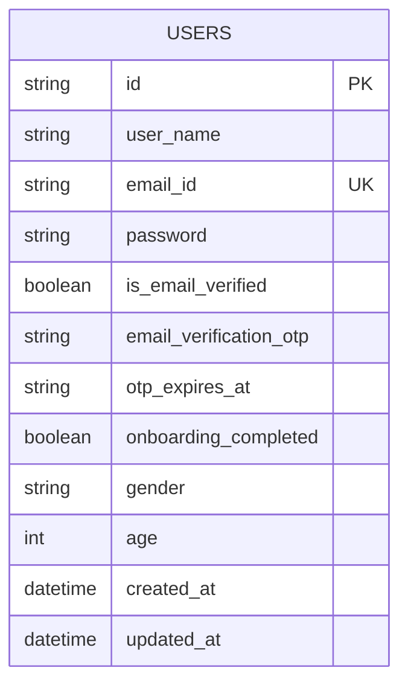

# Database Entity Relationship Diagram (ERD)

> Auto-generated from SQLModel definitions in `backend/db/sqlmodel_db.py`.

## Visual Diagram

## Relationships

| Source Entity | Relationship | Target Entity | Foreign Key Column | Description |
|---|:---:|---|---|---|
| *None explicitly linked* | - | - | - | - |

---

## Entities & Schema Details

### `users` (Users)

| Column | Type | Constraints | Nullable |
|---|---|---|:---:|
| `id` | `string` | PK | No |
| `user_name` | `string` | - | No |
| `email_id` | `string` | UK | No |
| `password` | `string` | - | Yes |
| `is_email_verified` | `boolean` | - | No |
| `email_verification_otp` | `string` | - | Yes |
| `otp_expires_at` | `string` | - | Yes |
| `onboarding_completed` | `boolean` | - | No |
| `gender` | `string` | - | Yes |
| `age` | `int` | - | Yes |
| `created_at` | `datetime` | - | No |
| `updated_at` | `datetime` | - | No |
